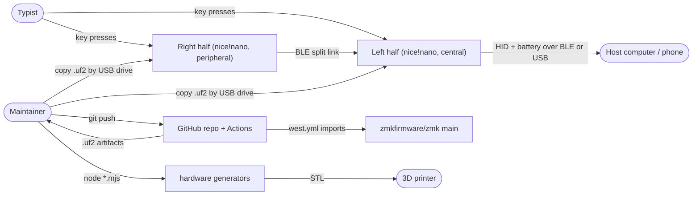
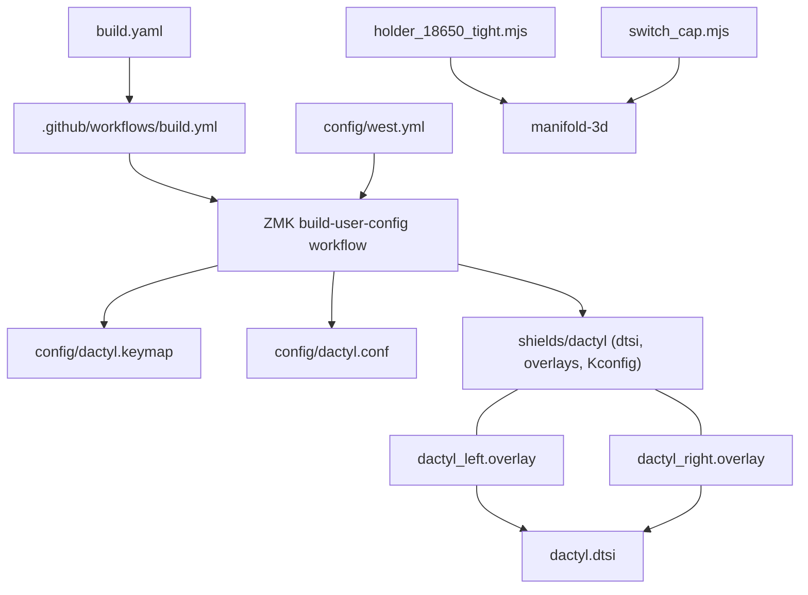
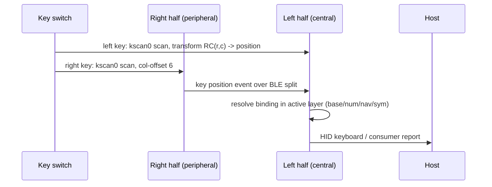
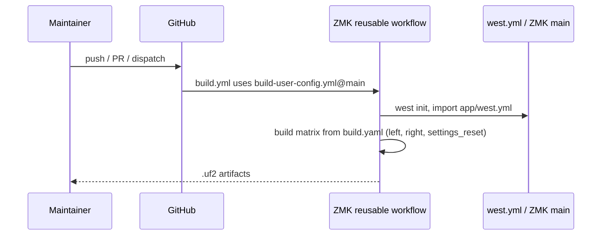
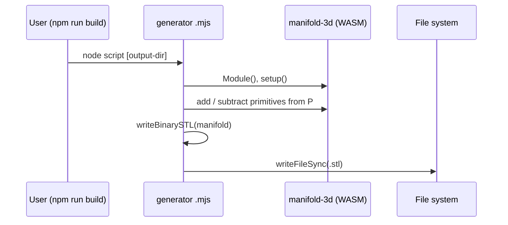

# Arquitectura

Architecture of the Dactyl 4x6 repository: a ZMK user-config for a split wireless keyboard plus two small Node generators for printed parts. There are no services, databases or DI container; checklist items that need them are marked `No aplica`. Feature ids (F1-F16) come from `docs/.work/catalog.json`; the per-process behavior lives in `docs/features/`.

Prior hand-written docs ([01-hardware.md](01-hardware.md) to [05-build-log.md](05-build-log.md)) are cited as context; where they contradict code, code wins and the difference is listed in `docs/preguntas-abiertas.md`.

## 1. Contexto

**Purpose.** Firmware configuration for a hand-wired Dactyl Manuform 4x6 split keyboard on two nice!nano controllers (`build.yaml:2-5`), written for a Spanish (ES) host layout (`config/dactyl.keymap:8-10`). The repository also versions the generators of two printed parts (battery holder, switch cap) (`hardware/18650-holder/package.json:6`, `hardware/switch-button/package.json:6`).

**Actors.**

| Actor | Interaction |
|---|---|
| Typist (owner) | Presses keys, holds layer keys, selects Bluetooth profiles (F1, F2, F7) |
| Maintainer | Edits `config/`, pushes to GitHub, flashes `.uf2` files by hand (F12, F14) |
| Host computer / phone | Receives HID keyboard and consumer reports and battery level over BLE or USB (F1, F11) |
| 3D printer operator | Prints the STLs produced by the generators (F15, F16) |

**External systems and stores.**

| System / store | Role | Evidence |
|---|---|---|
| ZMK firmware (`zmkfirmware/zmk`, branch `main`) | Application framework; this repo only supplies configuration | `config/west.yml:2-9` |
| GitHub Actions + ZMK reusable workflow | Builds the firmware | `.github/workflows/build.yml:6` |
| nice!nano (`nice_nano//zmk`) | Target board of both halves | `build.yaml:2-8` |
| Flash settings partition of each half | BLE bonds and profiles (written by ZMK, wiped by `settings_reset`) | `build.yaml:6-8` |
| STL files in `hardware/` | Output of the generators | `hardware/18650-holder/holder_18650_tight.mjs:261-266`, `hardware/switch-button/switch_cap.mjs:186` |

## 2. Estructura de la solución

Single Git repository, three kinds of modules. Only `hardware/*.mjs` is indexed by CodeGraph; the rest was read directly.

| Module | Path | Role | Depends on |
|---|---|---|---|
| Keymap | `config/dactyl.keymap` | Four layers (base 0, num 1, nav 2, sym 3) and two dead-key macros (F1-F7) | ZMK behaviors and key codes (`config/dactyl.keymap:1-3`), matrix transform of the shield |
| User settings | `config/dactyl.conf` | Kconfig options shared by both halves: sleep, battery reporting (F10, F11) | ZMK Kconfig |
| Shield `dactyl` | `config/boards/shields/dactyl/` | Matrix scan, matrix transform, split roles, keyboard name (F8, F9) | `pro_micro` node of the board (`dactyl.zmk.yml:6`) |
| West manifest | `config/west.yml` | Pulls ZMK `main` and its dependencies | `zmkfirmware/zmk` |
| Build matrix | `build.yaml`, `.github/workflows/build.yml` | Targets and CI entry (F12, F13) | ZMK reusable workflow |
| 18650 holder generator | `hardware/18650-holder/holder_18650_tight.mjs` | Parametric STL (F15) | `manifold-3d` |
| Switch cap generator | `hardware/switch-button/switch_cap.mjs` | Parametric STL (F16) | `manifold-3d` |
| Third-party parts | `hardware/third-party/` | Downloaded STLs with licenses; assets, not code | none |

Shield files (`dactyl.dtsi`, `dactyl_left.overlay`, `dactyl_right.overlay`, `Kconfig.shield`, `Kconfig.defconfig`, `dactyl.zmk.yml`) form one module: the overlays include the shared `.dtsi` (`dactyl_left.overlay:1`, `dactyl_right.overlay:1`), the Kconfig files decide roles from which shield is selected (`Kconfig.shield:1-5`).

**Matrix and key counts.** The shared transform declares 4 rows by 12 columns, 48 positions (`dactyl.dtsi:34-40`). The physical half has 23 keys (owner's statement, also `README.md:16`, `docs/01-hardware.md:15`), so each half leaves one of its 24 matrix positions unused: `RC(3,0)` on the left, `RC(3,6)` on the right (`dactyl.dtsi:29-31`, `docs/01-hardware.md:62-64`). The keymap fills both with `&none` (`config/dactyl.keymap:50`), giving 46 working keys. The transform still lists those two positions (`dactyl.dtsi:40`); this is the inconsistency resolved as item 1 in "Resuelto durante la documentación" of `docs/preguntas-abiertas.md` (the `.dtsi` comment says the key is missing, but the position is still mapped and bound).

## 3. Librerías

Direct dependencies only, from manifests.

| Dependency | Version | Used for | Evidence |
|---|---|---|---|
| `zmkfirmware/zmk` | revision `main` (unpinned) | Firmware framework, imports `app/west.yml` (Zephyr and modules) | `config/west.yml:5-9` |
| ZMK reusable workflow `build-user-config.yml` | `@main` (unpinned) | CI build of all targets | `.github/workflows/build.yml:6` |
| `manifold-3d` (npm) | `^3.5.4`, locked 3.5.4 | Boolean geometry and mesh output for the holder | `hardware/18650-holder/package.json:11`, `hardware/18650-holder/package-lock.json:805-806` |
| `manifold-3d` (npm) | `^3.5.4`, locked 3.5.4 | Same, for the switch cap | `hardware/switch-button/package.json:11`, `hardware/switch-button/package-lock.json:805-806` |
| Node built-ins `node:fs`, `node:path`, `node:url` | runtime-provided | STL write, output path | `hardware/18650-holder/holder_18650_tight.mjs:33-35`, `hardware/switch-button/switch_cap.mjs:33-35` |

No internal packages. The Node `engines` requirement is not declared in the two `package.json` files (inferido del código: any Node supporting top-level `await` and ES modules, since `"type": "module"` and `await Module()` are used (`hardware/18650-holder/package.json:5`, `holder_18650_tight.mjs:107`)).

## 4. Composición (DI)

`No aplica (there is no dependency injection container or runtime service registration)`. The analogous wiring is done at build time through devicetree and Kconfig:

- **Chosen nodes.** The shield selects its scanner and transform with `zmk,kscan = &kscan0` and `zmk,matrix-transform = &default_transform` (`dactyl.dtsi:4-7`).
- **Per-half specialization by overlay.** Each overlay includes the shared `.dtsi` and fills `col-gpios` of `&kscan0` (`dactyl_left.overlay:3-12`, `dactyl_right.overlay:3-12`); only the right overlay adds `col-offset = <6>` to `&default_transform` (`dactyl_right.overlay:15-18`).
- **Shield selection to Kconfig.** `SHIELD_DACTYL_LEFT` / `SHIELD_DACTYL_RIGHT` are true when the shield name is in the build's shield list (`Kconfig.shield:1-5`). Defaults: left gets `ZMK_KEYBOARD_NAME "Dactyl 4x6"` and `ZMK_SPLIT_ROLE_CENTRAL y`; both get `ZMK_SPLIT y` (`Kconfig.defconfig:1-16`). The right half therefore stays peripheral by omission (inferido del código: ZMK defaults `ZMK_SPLIT_ROLE_CENTRAL` to off).
- **Shared options.** `config/dactyl.conf` has no `_left`/`_right` suffix and applies to both halves (`config/dactyl.conf:1`).
- **Keymap bindings.** Layers and macros are devicetree nodes (`config/dactyl.keymap:19-90`).
- **Generator parameters.** Each generator holds a constant parameter object `P` edited in source (`hardware/switch-button/switch_cap.mjs:40-61`); the only runtime input is an optional output directory (`holder_18650_tight.mjs:257-259`, `switch_cap.mjs:182-184`).

## 5. Flujos

There are no HTTP, job or consumer entry points. The entry-point kinds here are key events, CI runs and CLI invocations.

### 5.1 Key press to host report (F1, F2, F3, F4, F5, F6, F8)

1. `kscan0` scans 4 rows by 6 columns per half, col2row diodes (`dactyl.dtsi:9-20`).
2. The matrix transform maps each (row, column) to a logical position 0..47; the right half is shifted by 6 and listed in reverse order (`dactyl.dtsi:23-41`, `dactyl_right.overlay:17`).
3. The right half sends its position over the BLE split link to the central (left) (`Kconfig.defconfig:6-8`, `Kconfig.defconfig:13-15`).
4. The central resolves the binding in the active layer (`config/dactyl.keymap:41-88`); `&mo LAYER_SYM|NAV|NUM` activates a layer while held (`config/dactyl.keymap:44,48,50`); macros type a dead key then space (`config/dactyl.keymap:25-35`).
5. ZMK emits a HID keyboard or consumer report to the host.

### 5.2 Bluetooth profile and battery (F7, F11)

Profile keys live on the NAV layer bottom row: `&bt BT_SEL 0/1/2` and `&bt BT_CLR` (`config/dactyl.keymap:71`). Battery: each half reports its level, the central fetches the peripheral's and proxies both (`config/dactyl.conf:8-12`); `BT_GATT_ENFORCE_SUBSCRIPTION=n` is a Windows workaround (`config/dactyl.conf:14-15`).

### 5.3 Idle sleep (F10)

`CONFIG_ZMK_SLEEP=y` with a 300000 ms timeout (`config/dactyl.conf:5-6`); any key wakes a half because `kscan0` declares `wakeup-source` (`dactyl.dtsi:12`). In the working tree the timeout line is uncommitted (git shows it as modified); the committed file keeps the 15 min default. Catalog entry F10 states the timeout is not set in the repo; that is out of date for the working tree.

### 5.4 Firmware build in CI (F12, F13)

Push, pull request or manual dispatch triggers the workflow (`.github/workflows/build.yml:2`), which delegates to ZMK's reusable workflow (`.github/workflows/build.yml:6`). It builds the `build.yaml` matrix: `dactyl_left`, `dactyl_right` and `settings_reset`, all for `nice_nano//zmk` (`build.yaml:1-8`). `settings_reset` wipes bonds when flashed (F13).

Flashing and pairing (F14) are manual steps documented in `README.md:64-65`; there is no code for them.

### 5.5 Parametric generators (F15, F16)

Both are CLI scripts with the same shape, run as `npm run build` or `node <script>.mjs [output-dir]` (`hardware/18650-holder/package.json:8`, `hardware/switch-button/package.json:8`):

1. Initialize the WASM kernel: `await Module(); wasm.setup()` (`holder_18650_tight.mjs:107-108`, `switch_cap.mjs:80-81`).
2. Build the solid from `P` with boolean add/subtract.
3. `writeBinarySTL` converts the mesh to a binary STL (`holder_18650_tight.mjs:230-255`, `switch_cap.mjs:155-179`).
4. Write to the script's own directory unless an output directory is passed (`holder_18650_tight.mjs:257-259`, `switch_cap.mjs:182-184`). The holder also writes a mirrored copy (`holder_18650_tight.mjs:265-266`).

`writeBinarySTL` is duplicated in both scripts (two definitions, one caller each). CodeGraph reports no covering tests for either.

## 6. Transacciones

`No aplica (no database or multi-store transactions)`. The nearest relevant behaviors, none of them transactional:

- STL output is a single `fs.writeFileSync` per file (`holder_18650_tight.mjs:253`, `switch_cap.mjs:178`). The holder writes two files in sequence (`holder_18650_tight.mjs:264-266`); a failure between them leaves one file updated and the other stale. Impact is low, as both are regenerated from source.
- BLE bonds and profiles live in each half's own flash; they are not synchronized atomically between halves, which is why `settings_reset` is flashed per half (`build.yaml:6-8`, F13).

## 7. Manejo de errores

`No aplica (no application-level error handling is written in this repo)`. What exists:

- Firmware: failures are ZMK/Zephyr's concern; the repo adds no handlers. Build-time errors surface as a failed GitHub Actions run (`.github/workflows/build.yml:6`).
- Generators: no `try/catch`, no argument validation; an unwritable output directory or WASM failure terminates the Node process with an unhandled exception (inferido del código: `holder_18650_tight.mjs:253`, `switch_cap.mjs:178` call `fs.writeFileSync` with no guard).
- One defensive guard in geometry: socket corner radius is clamped (`hardware/switch-button/switch_cap.mjs:67`).

## 8. Logging / observabilidad

`No aplica (no logging framework, sinks or metrics)`. The only output is two `console.log` lines in the holder (`holder_18650_tight.mjs:264-266`) and the equivalent in the cap script (`switch_cap.mjs:187`). In firmware, the only observable runtime signal is the BLE battery service (`config/dactyl.conf:8-12`, F11). ZMK logging (`CONFIG_ZMK_USB_LOGGING` and similar) is not enabled in `config/dactyl.conf`.

## 9. Seguridad

- **Authentication / authorization:** `No aplica (no users, services or APIs)`. The keyboard pairs over standard BLE bonding managed by ZMK; the repo changes no pairing or security Kconfig options (`config/dactyl.conf:1-15`).
- **Weakening setting:** `CONFIG_BT_GATT_ENFORCE_SUBSCRIPTION=n` disables a GATT subscription check, kept to make the battery level appear on Windows (`config/dactyl.conf:14-15`).
- **Secrets:** none in the repository; no secret keys are referenced by the workflow (`.github/workflows/build.yml:1-6`).
- **Supply chain:** ZMK `main` and the reusable workflow `@main` are unpinned (`config/west.yml:7`, `.github/workflows/build.yml:6`), so upstream changes enter the firmware without review. npm dependencies are locked by `package-lock.json`.
