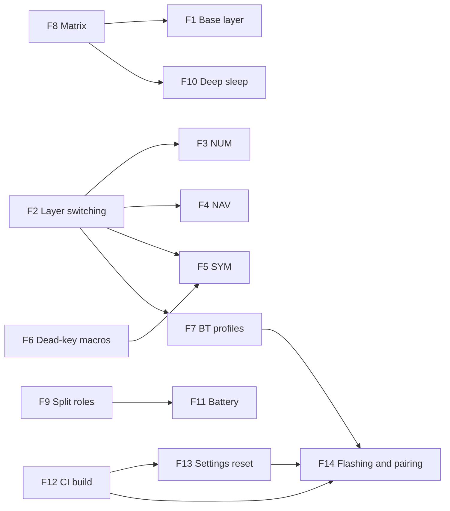

# Features

Each feature follows the template: Purpose, Trigger/Entry point, Inputs, Steps (with `file:line`), Exit points, Business rules, Errors and edge cases, Where to act, Existing tests, Coverage/Gaps. The catalog is cumulative: ids are never reused or renumbered.

This is firmware and hardware, not a service. A "process" is something with its own trigger: a key or layer in the keymap, a Kconfig switch, a CI job, or an `npm run build` generator.

| Id | Feature | Ticket | Document |
|---|---|---|---|
| F1 | Base layer typing (QWERTY, host in ES layout) | - | [capa-base-qwerty-es.md](capa-base-qwerty-es.md) |
| F2 | Momentary layer switching (SYM, NAV, NUM) | - | [cambio-de-capas.md](cambio-de-capas.md) |
| F3 | NUM layer | - | [capa-numeros.md](capa-numeros.md) |
| F4 | NAV layer (F-keys, arrows, media, Bluetooth keys) | - | [capa-navegacion-multimedia.md](capa-navegacion-multimedia.md) |
| F5 | SYM layer (symbols via Shift/AltGr on ES layout) | - | [capa-simbolos.md](capa-simbolos.md) |
| F6 | Dead-key literal macros (grave and caret) | - | [macros-teclas-muertas.md](macros-teclas-muertas.md) |
| F7 | Bluetooth profile selection and clearing | - | [gestion-perfiles-bluetooth.md](gestion-perfiles-bluetooth.md) |
| F8 | Key matrix scan and split matrix transform | - | [matriz-teclado-split.md](matriz-teclado-split.md) |
| F9 | Split roles and shield definition | - | [roles-split-ble.md](roles-split-ble.md) |
| F10 | Deep sleep on idle with key wake-up | - | [sueno-profundo.md](sueno-profundo.md) |
| F11 | Battery level reporting for both halves over BLE | - | [informe-bateria-ble.md](informe-bateria-ble.md) |
| F12 | Firmware build in GitHub Actions | - | [build-firmware-ci.md](build-firmware-ci.md) |
| F13 | Settings reset firmware (wipe BLE bonds) | - | [reset-ajustes-bonds.md](reset-ajustes-bonds.md) |
| F14 | Flashing and pairing workflow (documented only) | - | [flasheo-emparejado.md](flasheo-emparejado.md) |
| F15 | Parametric 18650 holder generator | - | [generador-soporte-18650.md](generador-soporte-18650.md) |
| F16 | Parametric switch cap generator | - | [generador-capuchon-pulsador.md](generador-capuchon-pulsador.md) |

No ticket ids exist in the git history or the docs, so every feature is `sin ticket`.

## Entry points -> features

| Entry point | Kind | Code | Feature(s) |
|---|---|---|---|
| `base_layer` keys | Config | `config/dactyl.keymap:41` | F1 (+ F8) |
| `&mo LAYER_SYM` | Config | `config/dactyl.keymap:44` | F2 (+ F5) |
| `&mo LAYER_NAV` | Config | `config/dactyl.keymap:48` | F2 (+ F4) |
| `&mo LAYER_NUM` (FN) | Config | `config/dactyl.keymap:50` | F2 (+ F3) |
| `num_layer` bindings | Config | `config/dactyl.keymap:54` | F3 |
| `nav_layer` bindings | Config | `config/dactyl.keymap:64` | F4 |
| `&bt BT_SEL 0/1/2`, `&bt BT_CLR` | Config | `config/dactyl.keymap:71` | F7 (+ F4) |
| `sym_layer` bindings | Config | `config/dactyl.keymap:77` | F5 |
| `macro_grave` / `macro_caret` | Config | `config/dactyl.keymap:25`, `:31` | F6 (+ F5) |
| `kscan0` / `default_transform` | Config | `config/boards/shields/dactyl/dactyl.dtsi:9`, `:32` | F8 (+ F1) |
| `dactyl_left` / `dactyl_right` overlays (`col-offset 6` on the right) | Config | `config/boards/shields/dactyl/dactyl_left.overlay:3`, `dactyl_right.overlay:3` | F8 |
| `Kconfig.defconfig` (left central, keyboard name, split) | Config | `config/boards/shields/dactyl/Kconfig.defconfig:1` | F9 |
| `Kconfig.shield`, `dactyl.zmk.yml` | Config | `config/boards/shields/dactyl/Kconfig.shield:1`, `dactyl.zmk.yml:1` | F9 |
| `CONFIG_ZMK_SLEEP=y` | Config | `config/dactyl.conf:5` | F10 |
| `CONFIG_ZMK_IDLE_SLEEP_TIMEOUT=300000` (uncommitted) | Config | `config/dactyl.conf:6` | F10 |
| `kscan0` `wakeup-source` | Config | `config/boards/shields/dactyl/dactyl.dtsi:12` | F10 (+ F8) |
| `CONFIG_ZMK_BATTERY_REPORTING` and central fetch/proxy | Config | `config/dactyl.conf:10-12` | F11 (+ F9) |
| `CONFIG_BT_GATT_ENFORCE_SUBSCRIPTION=n` | Config | `config/dactyl.conf:15` | F11 |
| "Build ZMK firmware" workflow (push, pull_request, workflow_dispatch) | Job | `.github/workflows/build.yml:2` | F12 |
| `build.yaml` target matrix | Config | `build.yaml:1` | F12 |
| `west.yml` ZMK `main` manifest (unpinned at line 8) | Config | `config/west.yml:1` | F12 |
| `settings_reset` build target | Config | `build.yaml:7` | F13 (+ F12) |
| Manual double-tap reset and `.uf2` copy (documented only) | CLI | `README.md:64` | F14 |
| `npm run build` / `node holder_18650_tight.mjs [output-dir]` | CLI | `hardware/18650-holder/package.json:7` | F15 |
| `npm run build` / `node switch_cap.mjs [output-dir]` | CLI | `hardware/switch-button/package.json:7` | F16 |

## Features -> exit points

| Feature | Exit |
|---|---|
| F1 | HID keyboard report (keycodes, `RA(SQT)` / `RA(BSLH)` for `{` `}`) |
| F2 | ZMK active layer state in RAM (set while the key is held) |
| F3 | HID keyboard report (`GRAVE`, `N1`..`N0`); `&trans` or `&none` elsewhere |
| F4 | HID keyboard report (F-keys, cursor and navigation keys, `DEL`); HID consumer report (volume, mute, prev, next, play); BLE profile writes through F7 keys |
| F5 | HID keyboard report (`LS(...)`, `RA(...)`, plain symbol keycodes, F6 macros) |
| F6 | HID keyboard report (`LBKT`+`SPACE`; `LS(LBKT)`+`SPACE`) |
| F7 | BLE active profile and bond state (flash settings); advertising change on switch (inferred) |
| F8 | ZMK key position events 0..47; right half reported over BLE to the central |
| F9 | BLE advertised name `Dactyl 4x6` (left build); split BLE link right to left |
| F10 | MCU deep sleep after `ZMK_IDLE_SLEEP_TIMEOUT` (5 min in the working tree, 15 min default at HEAD); wake on key press |
| F11 | BLE GATT Battery Service to the host (left level and proxied right level); split link from the right half |
| F12 | Workflow artifacts: `dactyl_left`, `dactyl_right`, `settings_reset` `.uf2` for `nice_nano//zmk` |
| F13 | Flash settings partition of the half erased (bonds, profiles) |
| F14 | nice!nano flash (`.uf2` copy); settings partition written on pairing (inferred) |
| F15 | `holder_18650_tight.stl`, `holder_18650_tight_mirrored.stl` (binary STL) and a stdout report |
| F16 | `switch_cap.stl` (binary STL) and a stdout report (`FIT PROBLEMS` or `fit : ok`) |

Data references: [../datos.md](../datos.md). Operations and risks: [../operaciones.md](../operaciones.md). Open questions: [../preguntas-abiertas.md](../preguntas-abiertas.md).

## Relations between features

